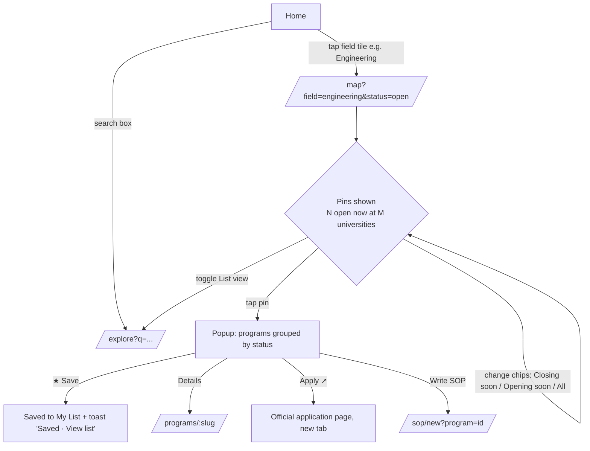
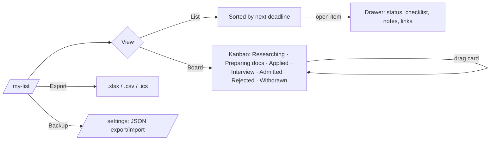
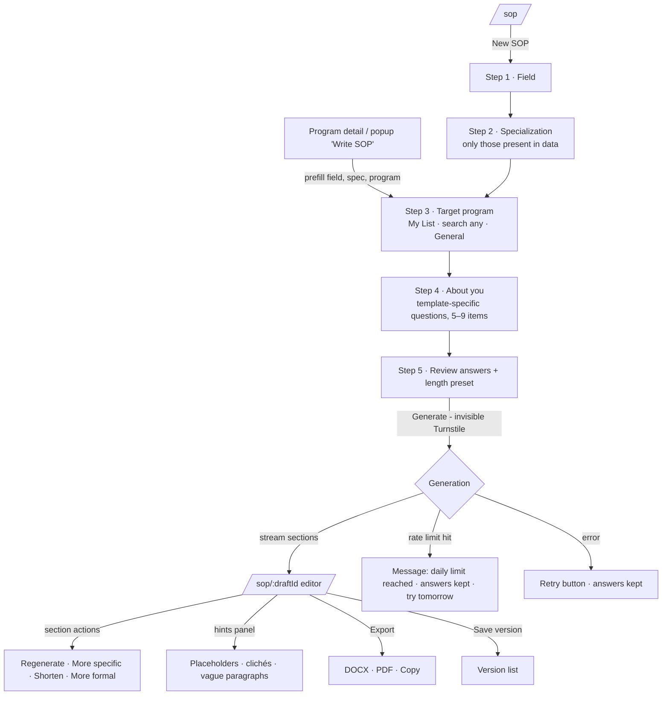
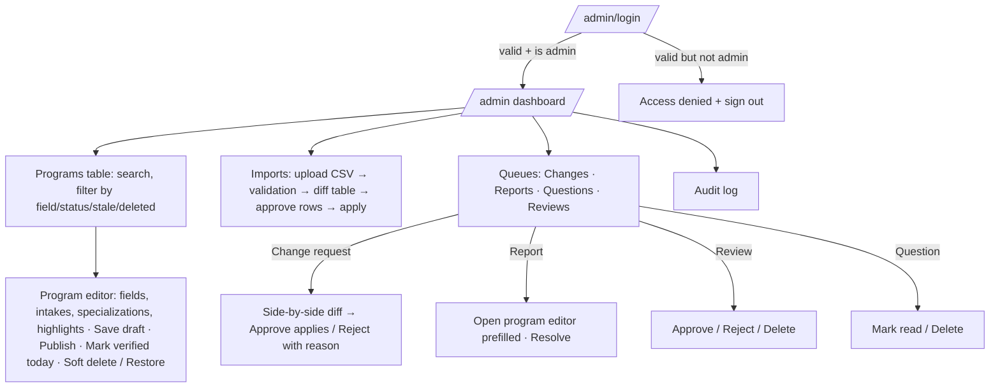

# 3 · App Flow Document

**Version:** 1.0 draft · **Date:** 2026-10-31 · **Related:** [PRD](01-PRD.md), [Design Brief](04-DESIGN-BRIEF.md)

---

## 1. Sitemap & routes

| Route | Screen | Access |
|---|---|---|
| `/` | Home — hero search, "Open now" summary by field, field tiles | Public |
| `/explore` | Program list with filters (URL-driven) | Public |
| `/map` | Admission-status map (same filters as `/explore`) | Public |
| `/programs/:slug` | Program detail | Public |
| `/universities/:slug` | University detail | Public |
| `/my-list` | Saved programs (list / kanban tracker) | Public (local data) |
| `/calendar` | Deadline calendar | Public |
| `/compare` | Compare 2–4 programs | Public |
| `/sop` | SOP drafts home (local drafts + "New SOP") | Public |
| `/sop/new` | SOP wizard (steps via `?step=`) | Public |
| `/sop/:draftId` | SOP editor | Public (local data) |
| `/contribute` | Suggest new program / update | Public |
| `/ask` | Ask a question | Public |
| `/faq` | FAQ | Public |
| `/settings` | Theme, backup export/import, clear data | Public |
| `/privacy`, `/about` | Static | Public |
| `/admin/login` | Admin login | Public |
| `/admin` | Dashboard | Admin |
| `/admin/programs`, `/admin/programs/:id` | Program table / editor | Admin |
| `/admin/universities`, `/admin/taxonomy` | Universities; fields & specializations | Admin |
| `/admin/imports`, `/admin/imports/:batchId` | CSV import & review | Admin |
| `/admin/queue/changes` · `/reports` · `/questions` · `/reviews` | Moderation queues | Admin |
| `/admin/audit` | Audit log | Admin |
| `*` | 404 | Public |

## 2. Global navigation

- **Desktop:** left sidebar — Explore · Map · My List · Calendar · Compare · SOP Writer · Contribute · FAQ; footer: theme toggle, settings, about.
- **Mobile:** bottom tab bar — Explore · Map · My List · SOP · More (sheet: Calendar, Compare, Contribute, Ask, FAQ, Settings).
- Global header: logo, search (opens `/explore?q=`), theme toggle, "Saved (n)" badge.
- Admin uses its own layout (top bar + left nav) and never appears in public nav.

## 3. Core flows

### Flow A — "What can I apply to now in my field?" (primary)

**Steps & states**
1. Home shows field tiles with live "N open now" counts.
2. Tapping a tile opens `/map` with `field` preset and status chip **Open now** active.
3. Summary bar: "12 programs open now at 9 universities · Engineering". Empty state: "Nothing open right now in Engineering — 7 programs open within 60 days" + button **Show opening soon**.
4. Pin tap → desktop popup / mobile bottom sheet.
5. Every action is one tap; Save toggles instantly (optimistic, local).

### Flow B — Explore & filter (list)
1. `/explore` loads dataset (skeleton cards while loading; cached data shows instantly on repeat visits).
2. Filters panel: Field → Specialization (dependent) · Status · Intake · Language · Degree · More filters (drawer: city, university, tuition, IELTS, MOI, VPD, NC, GRE/GMAT, portfolio, German level).
3. Every change updates URL and result count live; "Reset filters" clears.
4. Sort dropdown (Deadline · QS ranking · Tuition · Name) + direction.
5. Card/row → `/programs/:slug`. Card has Save, Compare checkbox, status badge + countdown.
6. Empty state suggests removing the most restrictive filter.

### Flow C — Program detail
Sections: Header (name, university, city, degree, language, status badge, countdown) → Actions bar (Save · Apply ↗ · Write SOP · Compare · Add to calendar · Report) → Intakes table (each intake with dates + status) → Requirements → Costs → Field & specializations → Highlights → Reviews (approved) → Links + "Last verified <date>" (+ stale warning if > 180 days).

### Flow D — My List & tracker

- First visit banner: "Saved only on this device. Export a backup anytime."
- Empty state: "No saved programs yet" + **Find open programs** → `/map?status=open`.
- Checklist auto-generated from requirements (e.g. VPD item only if `vpd_required`).

### Flow E — SOP writer

**Details**
- Wizard progress bar (5 steps); answers autosave to local draft after each step; back/forward safe.
- Step 4 example (Engineering/Science template): degree & university · CGPA (+ scale) · final-year project · 1–3 relevant projects/experiences (what, your role, result) · skills/tools · why this specialization · why Germany · why this program (optional, prompts with program highlights) · career goal (short + long term) · gaps or weaknesses to explain (optional).
- Business/MBA template replaces projects with work experience & impact, leadership, career switch reason. Arts & Design adds creative practice & portfolio themes. Law adds legal interests & jurisdiction background.
- Unanswered optional items become placeholders in the draft; the editor highlights them in amber until filled.
- Editor sidebar: word count vs target, hints, version history, disclaimer.

### Flow F — Contribute / Report / Ask / Review
1. **Contribute** (`/contribute`): choose *New program* or *Update existing* (search & pick). Form fields mirror program schema (required: university, program name, official link; others optional) + submitter name & email. Submit → Turnstile → success screen "Thanks — an admin will review it".
2. **Report wrong info** (from program page or popup): small dialog — what's wrong (deadline · link · requirement · other) + note + optional email → submit.
3. **Ask** (`/ask`): name, email, question → confirmation.
4. **Review** (program page): stars + comment + relation (current student / alumni / admitted) + name → "Visible after moderation".

### Flow G — Admin

## 4. Cross-cutting states

| State | Behaviour |
|---|---|
| First load | Branded skeleton; dataset fetched; cached data used if present |
| Offline / Supabase down | Banner "Showing saved data from <date>"; submissions & SOP disabled with explanation |
| Storage blocked | Toast once: "Saving is disabled in this browser mode"; app otherwise works |
| Stale program (> 180 days) | Amber "Dates may be outdated — check official page" on card, popup, detail |
| Unknown dates | Status "Dates not published" (grey); excluded from open counts |
| Errors | Inline, with retry; never lose user input |

## 5. Notifications & feedback
- Toasts for save/unsave, export done, submission sent.
- Confirm dialogs for destructive actions (clear local data, delete draft, admin delete).
- No email or push notifications in v1.
