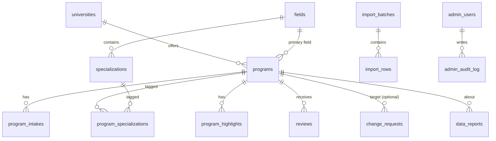

# 5 · Backend Schema Document

**Version:** 1.0 draft · **Date:** 2026-10-31 · **Platform:** Supabase (Postgres 15) · **Related:** [TRD](02-TRD.md)

---

## 1. Entity-relationship overview



Conventions: `id uuid primary key default gen_random_uuid()`, `created_at timestamptz default now()`, `updated_at timestamptz` (trigger-maintained), `slug text unique` for public URLs, soft delete via `deleted_at`. All dates without time use `date` and are interpreted in **Europe/Berlin**.

## 2. Enums

```sql
create type degree_type as enum ('MSc','MA','MEng','MBA','LLM','MEd','MFA','MPH','MRes','Other');
create type teaching_language as enum ('english','german','english_german');
create type intake_season as enum ('winter','summer');
create type application_portal as enum ('uni_assist','direct','hochschulstart','other');
create type university_type as enum ('university','university_applied_sciences','technical_university','art_music','other');
create type publish_state as enum ('draft','published');
create type moderation_status as enum ('pending','approved','rejected');
create type change_request_type as enum ('new_program','update_program');
create type report_kind as enum ('deadline','link','requirement','fee','other');
create type import_row_action as enum ('new','update','unchanged','error');
create type sop_template as enum ('engineering_science','computer_science','business','arts_design','law','social_humanities','medicine_health','education');
```

## 3. Tables

### 3.1 Reference data

**`fields`** — broad fields (ISCED-F based)
| Column | Type | Notes |
|---|---|---|
| id | uuid PK | |
| slug | text unique not null | `engineering` |
| name | text not null | "Engineering" |
| isced_code | text | e.g. `07` |
| icon | text | icon key |
| color | text | hex, matches design tokens |
| sop_template | sop_template not null | default template for SOPs |
| sort_order | int default 0 | |

**`specializations`**
| Column | Type | Notes |
|---|---|---|
| id | uuid PK | |
| field_id | uuid FK → fields not null | |
| slug | text not null | unique (field_id, slug) |
| name | text not null | "Mechatronics" |
| isced_code | text | narrow/detailed code, optional |
| sort_order | int default 0 | |

**`universities`**
| Column | Type | Notes |
|---|---|---|
| id | uuid PK | |
| slug | text unique not null | |
| name | text not null | |
| short_name | text | "TU Berlin" |
| type | university_type not null | |
| city | text not null | |
| state | text not null | Bundesland |
| lat, lng | numeric(9,6) not null | |
| website | text | |
| qs_ranking | text | "151-200" (ranges allowed) |
| qs_ranking_sort | int | numeric lower bound for sorting |
| created_at, updated_at, deleted_at | timestamptz | |

### 3.2 Programs

**`programs`**
| Column | Type | Notes |
|---|---|---|
| id | uuid PK | |
| slug | text unique not null | `tu-berlin-msc-computer-science` |
| university_id | uuid FK → universities not null | |
| field_id | uuid FK → fields not null | primary field |
| name | text not null | "M.Sc. Computer Science" |
| degree_type | degree_type not null | |
| teaching_language | teaching_language not null | |
| duration_semesters | smallint | |
| ects | smallint | |
| official_url | text not null | |
| application_url | text | |
| application_portal | application_portal | |
| tuition_fee_eur | numeric(8,2) | per semester; 0 = none |
| tuition_note | text | e.g. "non-EU €1,500/semester" |
| semester_contribution_eur | numeric(8,2) | |
| application_fee_eur | numeric(8,2) | |
| ielts_min | numeric(2,1) | |
| toefl_min | smallint | |
| english_note | text | non-numeric English requirement, e.g. "B2" |
| moi_accepted | boolean | null = unknown |
| german_level | text | `none`, `A2`, `B1`, `B2`, `C1`, `TestDaF 4x4`, `DSH-2` |
| vpd_required | boolean | |
| aps_required | boolean | for certain countries |
| nc_restricted | boolean | |
| gre_gmat | text | `none`, `recommended`, `required` + note |
| entrance_exam_interview | text | free text |
| portfolio_required | boolean default false | |
| work_experience_years | smallint | |
| min_gpa_note | text | |
| summary | text | 1–3 sentences |
| letter_note | text | e.g. "Requires motivation letter max 2 pages" |
| state | publish_state default 'draft' | |
| last_verified_at | date | |
| source_url | text | where data was verified |
| view_count | int default 0 | |
| save_count | int default 0 | anonymous increments |
| created_at, updated_at, deleted_at | timestamptz | |

Indexes: `(field_id)`, `(university_id)`, `(state, deleted_at)`, GIN trigram on `name` (`pg_trgm`).

**`program_intakes`**
| Column | Type | Notes |
|---|---|---|
| id | uuid PK | |
| program_id | uuid FK → programs on delete cascade | |
| season | intake_season not null | |
| academic_year | text not null | `2027/28`, or `2027` for summer |
| application_start | date | null = not stated |
| application_end | date | null = unknown |
| eu_end | date | optional separate EU deadline |
| note | text | "Rolling admission", etc. |

Unique `(program_id, season, academic_year)`. Check `application_start <= application_end`.

**`program_specializations`** — `(program_id FK, specialization_id FK)` composite PK.

**`program_highlights`**
| Column | Type | Notes |
|---|---|---|
| id | uuid PK | |
| program_id | uuid FK cascade | |
| kind | text check in (`module`,`lab`,`research_group`,`feature`) | |
| text | text not null | "Robotics Lab (RoboCup team)" |
| sort_order | int | |

### 3.3 Community & moderation

**`change_requests`**
| Column | Type | Notes |
|---|---|---|
| id | uuid PK | |
| type | change_request_type not null | |
| program_id | uuid FK → programs | required when `update_program` |
| payload | jsonb not null | proposed program/intake fields (validated by Zod) |
| submitter_name | text not null | |
| submitter_email | text not null | |
| submitter_phone | text | optional |
| note | text | |
| status | moderation_status default 'pending' | |
| reviewed_by | uuid FK → auth.users | |
| reviewed_at | timestamptz | |
| reject_reason | text | |
| created_at | timestamptz | |

**`data_reports`**
| Column | Type | Notes |
|---|---|---|
| id | uuid PK | |
| program_id | uuid FK not null | |
| kind | report_kind not null | |
| message | text | ≤ 1,000 chars |
| reporter_email | text | optional |
| resolved_at | timestamptz | |
| resolved_by | uuid FK → auth.users | |
| created_at | timestamptz | |

**`questions`**
| Column | Type | Notes |
|---|---|---|
| id | uuid PK | |
| name, email | text not null | |
| message | text not null | ≤ 2,000 chars |
| is_read | boolean default false | |
| deleted_at | timestamptz | |
| created_at | timestamptz | |

**`reviews`**
| Column | Type | Notes |
|---|---|---|
| id | uuid PK | |
| program_id | uuid FK not null | |
| rating | smallint check 1–5 | |
| comment | text | ≤ 2,000 chars |
| relation | text check in (`current_student`,`alumni`,`admitted`,`applicant`) | |
| display_name | text not null | |
| status | moderation_status default 'pending' | |
| reviewed_by, reviewed_at | | |
| created_at | timestamptz | |

### 3.4 Admin & operations

**`admin_users`** — `user_id uuid PK FK → auth.users`, `display_name text`, `created_at`.

**`admin_audit_log`**
| Column | Type | Notes |
|---|---|---|
| id | bigint identity PK | |
| actor | uuid FK → auth.users | |
| action | text | `program.update`, `change_request.approve`, … |
| entity | text | table name |
| entity_id | uuid | |
| before | jsonb | |
| after | jsonb | |
| created_at | timestamptz | |

**`import_batches`** — `id`, `file_path` (Storage), `uploaded_by`, `row_count`, `status` (`parsed`,`applied`,`discarded`), `created_at`.

**`import_rows`** — `id`, `batch_id FK`, `row_number`, `raw jsonb`, `parsed jsonb`, `action import_row_action`, `target_program_id uuid`, `errors text[]`, `approved boolean default false`, `applied_at`.

**`link_checks`** — `id`, `program_id`, `url`, `http_status int`, `ok boolean`, `checked_at`.

**`rate_limits`** — `key text` (`sha256(ip||salt)`), `bucket text` (`sop_generate`, `sop_rewrite`, `submit_change`, …), `day date`, `count int`; PK `(key, bucket, day)`. Purged after 48 h.

**`usage_daily`** — `day date`, `bucket text`, `count int`, PK `(day, bucket)` — global caps & stats (no PII).

**`site_stats`** — `key text PK`, `value bigint` (e.g. `total_views`).

## 4. Views

**`v_public_programs`** (anon-readable via RLS, `security_invoker`; compact list payload). University `state` is exposed as `german_state` to avoid clashing with the program's publish `state`.
```sql
create view v_public_programs with (security_invoker = false) as
select p.id, p.slug, p.name, p.degree_type, p.teaching_language,
       p.tuition_fee_eur, p.application_fee_eur, p.ielts_min, p.moi_accepted,
       p.german_level, p.vpd_required, p.nc_restricted, p.gre_gmat,
       p.portfolio_required, p.application_portal, p.last_verified_at,
       f.slug as field_slug,
       u.id as university_id, u.slug as university_slug, u.name as university_name,
       u.city, u.state, u.lat, u.lng, u.qs_ranking, u.qs_ranking_sort,
       coalesce(array_agg(distinct s.slug) filter (where s.slug is not null), '{}') as specialization_slugs,
       coalesce(jsonb_agg(distinct jsonb_build_object(
         'season', i.season, 'year', i.academic_year,
         'start', i.application_start, 'end', i.application_end)) filter (where i.id is not null), '[]') as intakes
from programs p
join universities u on u.id = p.university_id and u.deleted_at is null
join fields f on f.id = p.field_id
left join program_specializations ps on ps.program_id = p.id
left join specializations s on s.id = ps.specialization_id
left join program_intakes i on i.program_id = p.id
where p.state = 'published' and p.deleted_at is null
group by p.id, f.slug, u.id;
```

**`v_public_program_detail`** — full program row + highlights + approved review aggregate (avg rating, count).

**`v_public_reviews`** — approved reviews only (no reviewer metadata beyond display name & relation).

**`v_program_status`** — SQL mirror of the status engine (for admin counts):
```sql
-- per intake, using Berlin date
with today as (select (now() at time zone 'Europe/Berlin')::date d)
select i.program_id, i.id intake_id,
  case
    when i.application_end is null then 'unknown'
    when (i.application_start is null or i.application_start <= t.d) and i.application_end >= t.d
         and i.application_end - t.d <= 14 then 'closing_soon'
    when (i.application_start is null or i.application_start <= t.d) and i.application_end >= t.d then 'open'
    when i.application_start > t.d and i.application_start - t.d <= 60 then 'opening_soon'
    else 'closed'
  end as status
from program_intakes i cross join today t;
```

**`mv_admin_stats`** (materialised, refreshed daily) — programs per field, open-now per field, stale count (`last_verified_at < today − 180`), broken links, pending queue counts, top viewed/saved.

## 5. RPC functions

| Function | Caller | Purpose |
|---|---|---|
| `is_admin() returns boolean` | internal | `exists(select 1 from admin_users where user_id = auth.uid())` |
| `increment_program_view(p_id uuid)` | anon | +1 `view_count` (security definer; throttled client-side once per session) |
| `increment_program_save(p_id uuid, delta int)` | anon | ±1 `save_count` (clamped ≥ 0) |
| `increment_site_views()` | anon | +1 `site_stats.total_views` |
| `search_programs(filters jsonb, sort text, page int, page_size int)` | anon | Server-side search (enabled when dataset > 5,000) |
| `admin_upsert_program(payload jsonb)` | admin | Create/update program + intakes + specializations + highlights; audit |
| `admin_set_program_state(p_id, state)` | admin | Draft/publish; audit |
| `admin_mark_verified(p_id)` | admin | `last_verified_at = today`; audit |
| `admin_soft_delete_program(p_id)` / `admin_restore_program(p_id)` | admin | Soft delete/restore; audit |
| `admin_approve_change_request(id)` | admin | Apply payload via `admin_upsert_program`, set approved; audit |
| `admin_reject_change_request(id, reason)` | admin | |
| `admin_resolve_report(id)` | admin | |
| `admin_set_review_status(id, status)` / `admin_delete_review(id)` | admin | |
| `admin_mark_question_read(id, read)` / `admin_delete_question(id)` | admin | |
| `apply_import_rows(batch_id, row_ids uuid[])` | admin | Upsert approved rows; audit each |
| `check_rate_limit(key, bucket, max int) returns boolean` | service role only | Atomic increment-and-check |

All admin RPCs: `security definer`, `set search_path = public`, first line `if not is_admin() then raise exception 'forbidden'; end if;`.

## 6. Row-Level Security

RLS **enabled on every table**; default deny.

| Table | anon | authenticated (non-admin) | admin |
|---|---|---|---|
| fields, specializations | select | select | all |
| universities | select where `deleted_at is null` | same | all |
| programs, program_intakes, program_specializations, program_highlights | select only rows of published, non-deleted programs | same | all |
| reviews | select where `status='approved'` (prefer view) | same | all |
| change_requests, data_reports, questions | none (inserted by Edge Function with service role) | none | select/update/delete |
| admin_users, admin_audit_log, import_* , link_checks | none | none | select (audit insert only via RPC) |
| rate_limits, usage_daily | none | none | none (service role only) |
| site_stats | select | select | all |

Storage bucket `imports`: private; admin-only policies.

## 7. Edge Functions (HTTP API)

| Function | Method | Auth | Body (Zod) | Response |
|---|---|---|---|---|
| `public-submit` | POST | Turnstile | `{ kind: 'change_request'|'data_report'|'question'|'review', data: {...}, turnstileToken }` | `201 {id}` · `400` validation · `403` bot · `429` limit |
| `sop-generate` | POST | Turnstile | `{ template, fieldSlug, specializationSlug, programId?, answers: Record<string,string>, length: 'short'|'standard'|'long', turnstileToken }` | `200 text/event-stream` events: `section_start {id,title}`, `delta {text}`, `section_end`, `done {usage}` · `429 {retryAfter}` |
| `sop-rewrite` | POST | Turnstile | `{ sectionId, sectionText, instruction: 'regenerate'|'specific'|'shorter'|'formal', context: {template, fieldSlug, specializationSlug, programId?, answers}, turnstileToken }` | `200 text/event-stream` |
| `admin-import` | POST | Admin JWT | `{ filePath }` | `200 {batchId, counts}` |
| `link-checker` | POST | cron secret | — | `200 {checked, failed}` |

Common: CORS restricted to app origins (`ALLOWED_ORIGINS`); rate-limit keys are `HMAC(RATE_LIMIT_SECRET, ip | Berlin date)`, so the salt rotates daily without a stored secret table; 32 KB body limit; IP from `x-forwarded-for` hashed with daily salt; structured logs without PII.

## 8. Seed data

`supabase/seed/`:
- `fields.csv` — 12 broad fields with ISCED codes, colours, SOP templates.
- `specializations.csv` — ~8–15 per field (~120 total).
- `universities.csv` — start with the 45 universities from the reference dataset + others needed for non-CS fields.
- `programs.csv` + `intakes.csv` + `program_specializations.csv` + `highlights.csv` — 60 CS programs migrated + starter set (10–20 per field), each with `source_url` and `last_verified_at`.

CSV import format = program columns + `university_slug`, `field_slug`, `specialization_slugs` (pipe-separated), and intake columns `winter_year`, `winter_start`, `winter_end`, `summer_year`, `summer_start`, `summer_end` (schema: `importRowSchema` in `packages/shared/src/submissions.ts`; the admin Imports page offers a template).

## 9. Migrations order

1. `0001_extensions.sql` — `pgcrypto`, `pg_trgm`, `pg_cron`.
2. `0002_enums.sql`
3. `0003_reference.sql` — fields, specializations, universities.
4. `0004_programs.sql` — programs, intakes, specializations, highlights + triggers.
5. `0005_community.sql` — change_requests, data_reports, questions, reviews.
6. `0006_admin_ops.sql` — admin_users, audit, imports, link_checks, rate_limits, usage_daily, site_stats.
7. `0007_views.sql`
8. `0008_rpc.sql`
9. `0009_rls.sql`
10. `0010_cron.sql`
